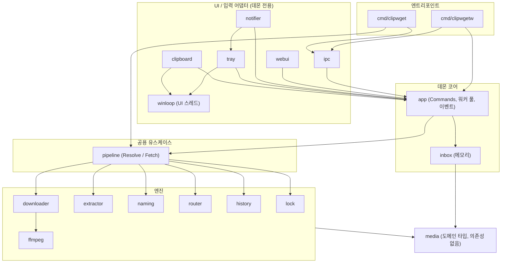
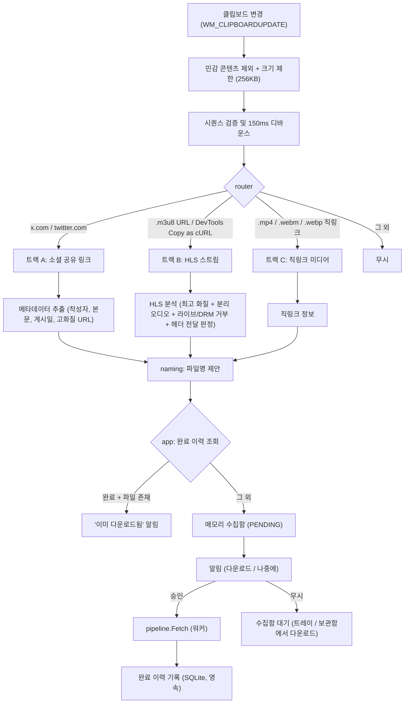

# ClipWget 소프트웨어 설계 명세서 (Software Design Specification)

> **한 줄 요약**: 클립보드 복사(`Ctrl+C`)만으로 소셜 공유 링크(`x.com`)와 개발자 도구에서 복사한 `.m3u8`(HLS) 스트림을 감지해 **휘발성 수집함**에 쌓아두고, 원할 때 받는 초경량 Windows 네이티브 유틸리티 (Pure Go)

- **관련 문서**: [구현 계획서 (implementation-plan.md)](./implementation-plan.md)
- **문서 원칙**: 이 문서가 동작 명세의 단일 기준입니다. 구현 계획서는 순서·체크리스트·검증만 다루며, 둘이 충돌하면 이 문서를 고칩니다.

---

## 1. 네이밍 및 프로젝트 정체성

| 구분 | 표기 | 설명 |
| :--- | :--- | :--- |
| **저장소 / Go 모듈** | `github.com/jinhoOps/clipwget` | Go 패키지 명명 규칙(하이픈 금지) 준수 및 `winget` 스타일의 단일어 조합 |
| **CLI 바이너리** | `clipwget.exe` | 콘솔 서브시스템. `get`, `list`, `watch` 등 CLI 명령 전용 (출력이 셸과 섞이지 않음) |
| **트레이 바이너리** | `clipwgetw.exe` | GUI 서브시스템(`-H=windowsgui`). 트레이 데몬 및 `clipwget://` 프로토콜 핸들러 (콘솔 창 없음) |
| **앱 타이틀 / 트레이 표기** | `ClipWget` | README, 시스템 트레이, Windows 알림에서의 가독성 확보 |

> 단일 GUI 바이너리 + `AttachConsole` 방식은 셸 프롬프트가 먼저 반환되고 출력이 뒤섞이는 고질적 문제가 있어, `go`/`gow`처럼 **두 개의 바이너리**로 분리합니다. 두 바이너리는 동일한 `internal/` 패키지를 공유합니다.

### 핵심 설계 목표
1. **초경량 상주 (목표 Idle 작업 집합 10~15MB)**: 평상시에는 브라우저 엔진 없이 Win32 메시지 루프와 트레이 아이콘만 유지합니다. 목표치는 Step 1의 메모리 측정 스파이크로 실현 가능성을 먼저 검증합니다.
2. **순수 Go 빌드 (`CGO_ENABLED=0`)**: C 컴파일러 의존성 없이 `go build`만으로 실행 파일을 생성합니다.
3. **휘발성 수집함(Volatile Inbox)**: 감지된 미디어는 즉시 다운로드하지 않고 **데몬 메모리 안의 수집함**에 `PENDING`으로 쌓입니다. 사용자는 알림·트레이·보관함 창에서 원할 때 받습니다. **앱을 종료하거나 PC를 끄면 수집함은 사라집니다.** 디스크에 영속되는 것은 완료된 다운로드 이력(중복 다운로드 방지용)뿐입니다.
4. **"알잘딱" 스트림 대응**: 일반 공유 링크가 막힌 사이트에서 사용자가 개발자 도구(F12) 네트워크 탭으로 복사한 원본 `.m3u8` URL 및 `Copy as cURL` 명령어까지 자동 해독합니다.

---

## 2. 시스템 아키텍처

### 2.1 프로세스 모델

| 프로세스 | 수명 | 역할 | 공유 자원 |
| :--- | :--- | :--- | :--- |
| **데몬** (`clipwgetw.exe`) | 로그인 세션 동안 상주 | 클립보드 감시, 수집함 보유, 다운로드 워커, 트레이·알림·웹 보관함 | 완료 이력 DB, 작업 잠금, Named Pipe 서버 |
| **프로토콜 핸들러** (`clipwgetw.exe "clipwget://..."`) | 수십 ms | 알림 버튼 명령을 파이프로 데몬에 전달 후 종료 (데몬이 없으면 데몬으로 승격) | Named Pipe 클라이언트 |
| **CLI** (`clipwget.exe`) | 명령 1회 | `get`은 데몬 없이 직접 다운로드, `list`/`history`는 파이프로 데몬 조회 | 완료 이력 DB, 작업 잠금, Named Pipe 클라이언트 |

데몬과 CLI가 **동시에 같은 미디어를 받거나 같은 이력 DB에 쓸 수 있으므로**, 다운로드는 항상 공용 파이프라인(§2.3)을 거치고 프로세스 간 잠금(§7.2)으로 직렬화합니다.

### 2.2 계층과 의존성 규칙



- **`internal/media`**: `LinkType`, `Source`(라우터 결과), `Item`(추출 결과), `Key`(중복 키), 공용 오류를 정의하는 **의존성 없는 도메인 패키지**입니다. 다른 모든 패키지는 서로의 타입 대신 이 타입을 주고받습니다 (예: `inbox`가 `router`/`extractor`를 import하지 않음).
- **`internal/pipeline`**: "텍스트 → 후보 목록"(`Resolve`)과 "후보 → 완성 파일"(`Fetch`)이라는 두 유스케이스를 구현합니다. **CLI `get`과 데몬이 같은 코드**로 다운로드하므로 잠금·이름 확정·이력 기록 규칙이 한 곳에만 존재합니다.
- **`internal/app`**: 데몬 전용 코어입니다. 수집함 상태 관리, 워커 풀, 이벤트 발행을 담당하고 UI 어댑터에는 `Commands` 인터페이스만 노출합니다.
- **UI 어댑터 규칙**: `tray`, `notifier`, `webui`, `ipc`는 **`app.Commands`와 읽기 전용 뷰(`ItemView`)에만 의존**하며 서로를 직접 호출하지 않습니다. 같은 동작(다운로드·재시도·제거·폴더 열기)은 어느 입구에서 오든 같은 `Commands` 메서드로 처리됩니다.
- **`inbox`는 이력을 모릅니다**: "이미 완료됨" 판정은 `app`이 `history`를 조회해 결정하고, `inbox`는 메모리 상태 전이만 담당합니다.

### 2.3 공용 파이프라인 (`internal/pipeline`)

```go
type Pipeline interface {
	// 클립보드 텍스트 또는 CLI 인자 → 다운로드 후보. 네트워크 메타데이터 조회 포함.
	Resolve(ctx context.Context, text string, hint naming.Context) ([]media.Item, error)
	// 후보 1건을 완성 파일로 만든다. 잠금 → 이력 재확인 → (소셜) 재추출 → 다운로드 → 이름 확정 → 이력 기록.
	Fetch(ctx context.Context, item media.Item, opt FetchOptions) (FetchResult, error)
}

type FetchOptions struct {
	Force    bool                 // 이미 완료된 항목도 다시 받기
	Progress func(done, total int64)
}

type FetchResult struct {
	SavedPath        string
	AlreadyCompleted bool  // 잠금 획득 후 이력 재확인 결과
	HistoryErr       error // 파일은 완성됐지만 이력 기록에 실패한 경우
}
```

`Fetch` 단계는 §7.3에 정의합니다.

### 2.4 데몬 스레드 모델

- **UI 스레드 1개** (`internal/winloop`): `runtime.LockOSThread()`로 고정된 단일 스레드가 **숨겨진 최상위 창 1개**와 메시지 루프를 소유합니다. 클립보드 리스너(`AddClipboardFormatListener`), 트레이 아이콘(`Shell_NotifyIconW`), 풍선 알림이 모두 이 창의 메시지를 사용합니다.
  - `HWND_MESSAGE`(메시지 전용 창)를 쓰지 않는 이유: 탐색기가 재시작될 때 브로드캐스트되는 `TaskbarCreated` 메시지는 최상위 창에만 전달되므로, 메시지 전용 창으로는 트레이 아이콘을 복구할 수 없습니다.
  - 다른 고루틴은 UI 스레드에 직접 Win32 호출을 하지 않고 `PostMessage(WM_APP+n)` + 채널로 작업을 넘깁니다.
- **워커 풀**: 다운로드 워커 기본 2개, 대기 큐 최대 200건. 메타데이터 조회(`Resolve`)는 클립보드 이벤트마다 별도 고루틴에서 수행하며 동시 4건으로 제한합니다.
- **이벤트**: `app`은 항목 상태가 바뀔 때마다 `ItemChanged` 이벤트를 발행합니다. 트레이(건수 표시)와 알림은 구독하고, 웹 보관함은 2초 주기 폴링으로 단순화합니다.

### 2.5 명령 인터페이스 (`app.Commands`)

```go
type Commands interface {
	Download(ref ItemRef) error      // PENDING/FAILED → 워커 큐 투입 (중복 클릭은 무시)
	Remove(ref ItemRef) error        // DOWNLOADING 항목은 거부
	OpenFolder(ref ItemRef) error    // explorer.exe /select,
	OpenHistory() error              // 웹 보관함 열기 (실행 중이면 기존 서버 재사용)
	ListInbox() []ItemView
	SetWatching(on bool)
	SetAutoDownload(on bool)
	Quit()
}

type ItemRef struct {
	SessionID string // 다른 세션 값이면 ErrExpired
	ID        uint64
}
```

---

## 3. 감지 파이프라인 (Dual-Track)



---

## 4. 트랙별 상세 감지 및 파싱 명세

### 4.1 트랙 A: 소셜 공유 링크 (`x.com` / `twitter.com`)
- **대상 URL 패턴**:
  - `https://x.com/<user>/status/<id>` (및 `/video/N`, `/photo/N` 미디어 순번 접미사 포함)
  - `twitter.com`, `fxtwitter.com`, `vxtwitter.com`, `fixupx.com`, `/i/status/<id>` 변형 주소 지원
- **메타데이터 추출 전략**:
  - **1순위**: `https://api.fxtwitter.com/<user>/status/<id>` — 로그인/API 키 없이 작성자 ID, 본문, 업로드 타임스탬프, 최고 비트레이트 MP4 주소, 썸네일 추출
  - **2순위 (폴백)**: `https://api.vxtwitter.com/<user>/status/<id>` 자동 전환
  - 두 서비스 모두 제3자 비공식 API이므로 응답 스키마 변경·장애에 대비해 방어적으로 파싱하고, 실패 시 명확한 오류를 남깁니다.
- **다운로드 직전 재추출**: 감지와 다운로드 사이에 MP4 서명 URL이 만료될 수 있으므로, `Fetch` 시 메타데이터를 다시 조회하고 **같은 미디어 순번**의 URL을 사용합니다. 해당 순번이 사라졌으면 `FAILED`로 표시합니다.
- **썸네일**: `pbs.twimg.com` 이미지는 `?format=webp&name=small`로 요청하고 `%TEMP%\ClipWget\thumbs\`에 캐시합니다 (앱 시작·종료 시 비움, 수집함과 같은 수명). 썸네일 요청에는 인증 헤더를 붙이지 않습니다.
- **확장성**: 공통 `Extractor` 인터페이스로 추상화하여 추후 타 플랫폼이나 선택적 `yt-dlp` 폴백을 기존 코드 수정 없이 추가할 수 있게 합니다.

### 4.2 트랙 B: "알잘딱" `.m3u8` 감지 및 처리
웹 페이지에서 다운로드 버튼이나 공유 주소가 제공되지 않을 때 개발자 도구에서 복사한 스트림을 처리합니다.

1. **감지 방식 3단계**:
   - **정규식 매칭**: 만료 토큰·쿼리가 붙은 `https?://[^\s"'<>]+?\.m3u8(\?[^\s"'<>]*)?` 감지
   - **DevTools `Copy as cURL` 해독**: `curl "https://...m3u8..." -H "Referer: ..." -H "Cookie: ..."` 형태 텍스트에서 URL과 헤더(`Referer`, `Origin`, `Cookie`, `User-Agent`, `Authorization`)를 추출합니다. **파싱만 하며 셸로 실행하지 않습니다.**
     - **bash 형식**: 작은따옴표 인용, `\` 줄 연속, `$'...'` 이스케이프
     - **cmd 형식**: 큰따옴표 인용, `^` 줄 연속 및 `^"`, `^%` 등 캐럿 이스케이프
     - `-b`/`--cookie`는 `Cookie` 헤더로 변환합니다. `Copy as PowerShell`/`fetch`는 지원 범위 밖입니다.
     - 헤더 이름·값에 `\r`/`\n`이 있으면 해당 입력 전체를 거부합니다 (헤더 주입 방지).
   - **`#EXTM3U` 시그니처 프로빙**: 확장자가 명확하지 않은 스트림 의심 URL(`/hls/`, `/manifest/` 등)은 1.5초 타임아웃의 `Range: bytes=0-255` 요청으로 첫 줄을 확인합니다. 서버가 Range를 무시해도 256바이트까지만 읽습니다. 로컬호스트·사설 IP 대역은 프로빙하지 않습니다.
2. **HLS Master Playlist 파싱**:
   - `#EXT-X-STREAM-INF`가 있으면 `BANDWIDTH`와 `RESOLUTION`을 비교해 최고 화질을 선택합니다.
   - 세로형 영상(`1080x1920`)도 짧은 변(`min(width, height)`) 기준으로 `1080p`로 표기합니다.
   - **분리형 오디오**: `#EXT-X-MEDIA:TYPE=AUDIO,GROUP-ID="...",URI="..."`로 분리된 스트림(`video.twimg.com` 등)은 선택된 variant의 `AUDIO` 그룹에서 오디오 URI를 함께 추출해 FFmpeg에서 병합합니다. `DEFAULT=YES` 트랙을 우선합니다.
   - 상대 경로 URI는 해당 플레이리스트 URL 기준으로 `ResolveReference` 처리합니다.
3. **처리 가능 여부 판정 (선택된 Media Playlist 확인)**:
   - **라이브 스트림**: `#EXT-X-ENDLIST`가 없으면 "라이브 스트림은 지원하지 않습니다"로 거부합니다. 종료된 `EVENT` 플레이리스트(`ENDLIST` 있음)는 허용합니다.
   - **DRM**: `#EXT-X-KEY:METHOD=SAMPLE-AES` 또는 Widevine/FairPlay `KEYFORMAT`이 있으면 거부합니다.
   - **AES-128**: 지원합니다 (키 요청도 §4.2-4 헤더 정책을 따름).
   - **fMP4 세그먼트**(`#EXT-X-MAP`): 지원합니다.
4. **인증 헤더 전달 정책**:
   FFmpeg의 `-headers`는 플레이리스트가 가리키는 **모든 호스트**에 같은 헤더를 보내며 호스트별로 나눌 수 없습니다. 그래서 FFmpeg에 넘기기 전에 Go에서 정책을 결정합니다.
   - `Referer`, `Origin`, `User-Agent`는 항상 전달합니다 (비밀 정보가 아님).
   - `Cookie`, `Authorization`은 Master·Media 플레이리스트에 등장하는 **모든 URI(variant, 오디오, 세그먼트, 키, `EXT-X-MAP`)의 호스트가 원본 URL과 같은 사이트(eTLD+1)일 때만** 전달합니다.
   - 다른 사이트 호스트가 섞여 있으면 인증 헤더를 빼고 진행합니다. 이후 HTTP 401/403으로 실패하면 `FAILED`와 "인증이 필요한 스트림입니다. DevTools에서 다시 복사해 주세요"를 표시합니다.
   - 라이브 스트림은 이미 거부했으므로 FFmpeg가 다시 읽는 플레이리스트도 Go가 검사한 것과 같습니다.

### 4.3 트랙 C: 직링크 미디어
- `.mp4`, `.webm`, `.webp` 확장자 URL을 그대로 HTTP로 받습니다. 미디어 순번은 항상 0입니다.

---

## 5. 미디어 식별 규칙 (`internal/media`)

| 항목 | 규칙 |
| :--- | :--- |
| **소셜 미디어 순번** | 원본 게시물 미디어 배열의 **1-based** 순번. 영상이 1개뿐인 게시물도 `1`입니다. 일반 URL과 `/video/1` URL은 같은 키 `(x:<id>, 1)`이 됩니다. |
| **라우터 순번** | `Source.MediaIndex == 0`은 "지정 안 함(게시물의 모든 미디어)", `N ≥ 1`은 해당 순번만을 뜻합니다. |
| **HLS / 직링크 순번** | 항상 `0` |
| **소셜 중복 키** | `x:<status_id>` (호스트·사용자명 무관) |
| **HLS / 직링크 중복 키** | 정규화 URL의 SHA-256. 정규화: 스킴·호스트 소문자화, 기본 포트·fragment 제거, **호스트별 등록 목록에 있는 인증 쿼리 파라미터만 제거**(예: `video.twimg.com`의 `tag` 등은 유지하고 서명 파라미터만 제거). 목록에 없는 호스트는 전체 쿼리를 유지합니다. |
| **실제 요청 URL** | 정규화와 무관하게 사용자가 복사한 URL을 그대로 사용합니다. |
| **표시용 URL** | 완료 이력·로그에는 사용자정보·쿼리·fragment를 제거한 URL만 남깁니다. |

> **알려진 한계**: 등록되지 않은 호스트의 만료 토큰 스트림은 복사할 때마다 키가 달라져 중복으로 인식되지 않습니다. 자주 쓰는 호스트를 목록에 추가하는 방식으로 보완합니다.

---

## 6. 파일명 포매팅 규칙 (`internal/naming`)

| 구분 | 생성 포맷 예시 | 세부 정제 규칙 |
| :--- | :--- | :--- |
| **소셜 링크 (본문 있음)** | `@cherri0355 오늘 날씨가 좋네요_261103_2014.mp4` | 본문 내 URL·해시태그(`#태그`) 제거, 개행→공백 치환, 최대 40자(rune) 축약, 게시 시각(`YYMMDD_HHmm`) 부착 |
| **소셜 링크 (본문 없음)** | `@cherri0355_261103_2014.mp4` | 해시태그/링크 제거 후 본문이 비어 있으면 작성자+시각만 표기 |
| **다중 미디어 게시물** | `@cherri0355 여행 기록_261103_2014_2.mp4` | 게시물에 미디어가 **2개 이상일 때만** `_N` 순번 접미사를 붙입니다 |
| **m3u8 (기본)** | `[stream_twimg] 1080p_261103_2035.mp4` | 도메인 핵심 이름 + 해상도 + 감지 시각 (`Referer`/경로 슬러그 힌트 반영) |
| **m3u8 (문맥 매칭)** | `@cherri0355 오늘 날씨가 좋네요_1080p_261103_2035.mp4` | 아래 문맥 매칭 조건을 모두 만족할 때만 |

- **시각 표기**: 모든 `YYMMDD_HHmm`은 **로컬 시간대**로 표기합니다.
- **문맥 매칭**: `app`이 메모리에 "가장 최근 소셜 메타데이터 1건 + 감지 시각"을 보관합니다. HLS 감지 시 **3분 이내**이고 **연관 근거**(cURL의 `Referer`가 해당 게시물 URL이거나, 스트림 호스트가 해당 플랫폼의 미디어 호스트)가 있을 때만 소셜 제목을 사용합니다. 영속하지 않습니다.
- **Windows NTFS 안전 정제**: 금지 문자(`< > : " / \ | ? *` 및 `0x00-0x1F`), 예약어(`CON`, `PRN`, `AUX`, `NUL`, `COM1~9`, `LPT1~9`), 후행 마침표/공백을 제거합니다.
- **경로 길이**: 최종 경로(`저장 폴더\파일명`)가 260자를 넘으면 본문 요약을 더 줄이고, 그래도 넘으면 작성자/도메인+시각만 남깁니다. 임시 파일은 고정된 짧은 이름(§7.3)을 쓰므로 계산에 포함하지 않습니다.
- **중복 이름**: `naming`은 이름을 "제안"만 합니다. 실제 ` (2)`, ` (3)` 부여는 파일 확정 단계(§7.3)에서 원자적으로 처리합니다.

---

## 7. 저장 모델과 파일 안전성

### 7.1 휘발성 수집함 (`internal/inbox`, 메모리 전용)

수집함은 데몬 메모리 안의 맵(`sync.Mutex` 보호)으로만 존재하며 **디스크에 기록하지 않습니다.**

```go
type Status string

const (
	StatusPending     Status = "PENDING"
	StatusDownloading Status = "DOWNLOADING"
	StatusCompleted   Status = "COMPLETED"
	StatusFailed      Status = "FAILED"
)

type Item struct {
	ID            uint64     // 세션 내 증가 ID
	Media         media.Item // 키, 순번, 스트림/오디오 URL, 헤더(메모리 전용), 메타데이터, 제안 파일명
	Status        Status
	ErrorMessage  string
	SavedPath     string
	ThumbnailPath string     // %TEMP%\ClipWget\thumbs\ 캐시 경로
	DetectedAt    time.Time
	LastSeenAt    time.Time  // 마지막 재복사 시각 (5초 쿨다운 판정)
}
```

- **수명**: 앱 종료, 로그오프, PC 종료/재부팅, 크래시 시 소멸합니다 (의도된 동작).
- **세션 식별자**: 데몬 시작 시 임의의 `SessionID`(16바이트 hex)를 생성해 알림 버튼 URI에 넣습니다. 이전 세션 알림이 새 세션의 같은 번호 항목을 가리키는 문제를 막습니다.
- **상태 전이**: `MarkDownloading`은 잠금 안에서 `PENDING`/`FAILED`일 때만 성공합니다. 중복 클릭은 작업을 추가하지 않습니다.
- **상한**: 최대 200건. 초과 시 가장 오래된 `COMPLETED` → `FAILED` → `PENDING` 순으로 제거하며, `DOWNLOADING` 항목은 제거 대상에서 제외합니다.
- **민감 헤더**: `Cookie`/`Authorization`은 이 메모리 구조에만 존재하며 디스크·로그에 기록되지 않습니다.

#### 중복 복사 정책 (`media.Key` 기준, `app`이 판정)
| 상황 | 동작 |
| :--- | :--- |
| 5초 이내 같은 키 재감지 | 무시 (클립보드 중복 이벤트) |
| 수집함에 `PENDING`/`FAILED` | 최신 메타데이터·토큰·헤더로 갱신하고 알림 재표시 |
| 수집함에 `DOWNLOADING` | "다운로드 중입니다" 알림만 표시 |
| 완료 이력에 있음 + 파일 존재 | "이미 다운로드된 미디어입니다" + `[폴더에서 보기]` / `[다시 받기]` |
| 완료 이력에 있음 + 파일 없음 | 새 항목처럼 `PENDING` 등록 |

### 7.2 완료 이력 (`internal/history`, `modernc.org/sqlite`)

"이미 받은 미디어인지" 판정과 보관함 `완료` 탭 표시를 위해 **완료된 다운로드만** 영속합니다. 경로는 `%LOCALAPPDATA%\ClipWget\clipwget.db`(포터블 모드 시 `./data/clipwget.db`)입니다. 헤더·쿠키는 저장하지 않습니다.

```sql
-- PRAGMA user_version = 1
CREATE TABLE IF NOT EXISTS completed_downloads (
    id              INTEGER PRIMARY KEY AUTOINCREMENT,
    dedupe_key      TEXT NOT NULL,                  -- x:<id> 또는 정규화 URL의 SHA-256
    media_index     INTEGER NOT NULL DEFAULT 0,     -- 소셜 1-based, 그 외 0
    display_url     TEXT NOT NULL,                  -- 사용자정보·쿼리·fragment 제거
    link_type       TEXT NOT NULL,                  -- 'SOCIAL_TWITTER', 'STREAM_HLS', 'DIRECT'
    author          TEXT NOT NULL DEFAULT '',
    title           TEXT NOT NULL DEFAULT '',
    resolution      TEXT NOT NULL DEFAULT '',
    saved_path      TEXT NOT NULL,                  -- 마지막으로 성공한 로컬 절대 경로
    completed_at    TEXT NOT NULL,                  -- RFC 3339 UTC (표시 시 로컬 변환)
    UNIQUE (dedupe_key, media_index)
);

CREATE INDEX IF NOT EXISTS idx_completed_at
    ON completed_downloads(completed_at DESC);
```

- **연결 설정**: `journal_mode=WAL`, `busy_timeout=5000`, `MaxOpenConns(1)`. 데몬과 CLI 두 프로세스가 같은 DB에 쓰므로 `busy_timeout`이 없으면 동시 쓰기가 즉시 `SQLITE_BUSY`로 실패합니다.
- **기록 방식**: `INSERT ... ON CONFLICT(dedupe_key, media_index) DO UPDATE SET saved_path=..., completed_at=...` upsert로 마지막 성공 경로를 갱신합니다.
- **마이그레이션**: `PRAGMA user_version`으로 버전을 관리하고 시작 시 순차 적용합니다.
- **시각**: UTC RFC 3339 문자열로 저장합니다 (`CURRENT_TIMESTAMP` 의존 금지).
- **대안**: Step 1 메모리 측정에서 SQLite 상주 비용이 목표를 크게 넘으면 같은 `history.Store` 인터페이스 뒤에서 JSON Lines로 교체합니다. 이 경우에도 프로세스 간 잠금과 "임시 파일 작성 → 교체" 방식의 원자적 재작성을 지켜야 합니다.

### 7.3 다운로드 실행 단계 (`pipeline.Fetch`)

| 단계 | 내용 |
| :--- | :--- |
| 1. 작업 잠금 | Windows 이름 있는 뮤텍스 `Local\ClipWget-job-<키 해시>`를 획득합니다. 데몬과 CLI가 같은 미디어를 동시에 받지 않습니다. |
| 2. 이력 재확인 | 잠금 획득 후 완료 이력을 다시 조회합니다. 완료 + 파일 존재면 `Force`가 아닌 한 `AlreadyCompleted`로 끝냅니다. |
| 3. 재추출 | 소셜 항목은 메타데이터를 다시 조회해 같은 순번의 최신 URL을 사용합니다 (§4.1). |
| 4. 작업 폴더 | `<저장 폴더>\.clipwget-work\<작업 UUID>\`를 만들고 소유 표식 파일 `.owner`(PID, 시작 시각)를 열어 둔 채 유지합니다. 같은 볼륨이므로 최종 이동이 원자적입니다. |
| 5. 다운로드 | HTTP 또는 FFmpeg로 작업 폴더 안 고정 이름 `media.part`에 기록합니다. |
| 6. 이름 확정 | `windows.MoveFileEx(..., MOVEFILE_WRITE_THROUGH)`를 **`MOVEFILE_REPLACE_EXISTING` 없이** 호출합니다. 대상이 이미 있으면(`ERROR_ALREADY_EXISTS`/`ERROR_FILE_EXISTS`) ` (2)`, ` (3)`…으로 바꿔 재시도합니다. 기존 파일을 덮어쓰지 않으며, 별도 이름 예약 단계가 필요 없습니다. |
| 7. 이력 기록 | upsert합니다. 실패하면 완성 파일은 그대로 두고 `HistoryErr`로 따로 알립니다. |
| 8. 정리 | 작업 폴더를 삭제하고 잠금을 해제합니다. |

- Go의 `os.Rename`은 Windows에서 `MOVEFILE_REPLACE_EXISTING`을 사용해 **기존 파일을 덮어쓰므로** 최종 이동에 사용하지 않습니다.
- **취소**: 앱 종료나 취소 시 `context`로 HTTP·FFmpeg를 중단하고 작업 폴더를 삭제합니다.
- **시작 시 청소**: `.clipwget-work\` 아래에서 `.owner`가 있고 그 파일을 열 수 있는(= 소유 프로세스가 끝난) 폴더만 삭제합니다. 다른 프로세스가 사용 중인 작업 폴더나 앱이 만들지 않은 파일은 건드리지 않습니다.
- **만료 실패**: HLS가 인증 만료 등으로 실패하면 `FAILED`와 재복사 안내를 표시하고 자동 재시도하지 않습니다.

### 7.4 입력 제한

| 대상 | 크기 상한 | 타임아웃 |
| :--- | :--- | :--- |
| 클립보드 텍스트 | 256KB (초과 시 무시) | — |
| 메타데이터 JSON (fxtwitter/vxtwitter) | 2MB | 10초 |
| 플레이리스트 (Master/Media 각각) | 4MB | 10초 |
| 썸네일 | 2MB | 10초 |
| HLS 프로빙 | 256바이트 | 1.5초 |

모든 응답 본문은 `io.LimitReader`로 읽어, 서버가 `Content-Length`나 Range를 무시해도 상한을 넘지 않습니다.

---

## 8. FFmpeg 전략

### 8.1 탐색 및 자동 준비
1. **앱 로컬 폴더**: `<exe_dir>\ffmpeg.exe`, `<exe_dir>\bin\ffmpeg.exe`, `%LOCALAPPDATA%\ClipWget\bin\ffmpeg.exe`
2. **시스템 PATH**: `exec.LookPath("ffmpeg")`
3. **자동 설치 (사용자 승인 시)**: BtbN/FFmpeg-Builds GitHub Releases의 `win64-gpl` **고정 버전 ZIP**을 받아 **코드에 고정된 SHA-256**과 대조한 뒤 `ffmpeg.exe`만 `%LOCALAPPDATA%\ClipWget\bin\`에 추출합니다. 해시가 다르면 중단합니다. 버전 갱신은 릴리스로만 합니다.

### 8.2 무손실 Stream Copy 명령

**단일 입력**:
```text
ffmpeg.exe -nostdin -y -loglevel error -protocol_whitelist http,https,tcp,tls,crypto ^
  [-headers "Referer: ...\r\n"] -i "<stream_url>" ^
  -c copy -movflags +faststart -f mp4 "<작업 폴더>\media.part"
```

**분리 오디오**:
```text
ffmpeg.exe -nostdin -y -loglevel error -protocol_whitelist http,https,tcp,tls,crypto ^
  [-headers "..."] -i "<video_url>" ^
  [-headers "..."] -i "<audio_url>" ^
  -map 0:v:0 -map 1:a:0 -c copy -movflags +faststart -f mp4 "<작업 폴더>\media.part"
```

- **`-f mp4`**: 출력 확장자가 `.part`라 형식을 추론할 수 없으므로 필수입니다.
- **입력별 `-headers`**: 바로 뒤 `-i`에만 적용되므로 입력마다 반복합니다. 값은 §4.2-4 정책으로 걸러진 헤더입니다.
- **`-protocol_whitelist`에 `file` 제외**: 원격 플레이리스트가 로컬 파일 경로를 참조하지 못하게 합니다.
- **`aac_adtstoasc` 미지정**: FFmpeg의 MP4 muxer가 ADTS AAC를 감지하면 이 필터를 자동으로 삽입하므로 직접 지정하지 않습니다 (코덱 판정 로직 불필요). 실제 동작은 릴리스 게이트의 TS 통합 테스트로 확인합니다.
- **콘솔 창 방지**: `SysProcAttr{HideWindow: true, CreationFlags: CREATE_NO_WINDOW}`
- **알려진 한계**: `-headers` 값은 명령줄 인자로 전달되어 같은 사용자 세션의 다른 프로세스가 볼 수 있습니다. 로컬 단일 사용자 도구로서 허용합니다.

---

## 9. Windows 통합

### 9.1 알림 (`internal/notifier`) — 단계적 구현
알림은 `Notifier` 인터페이스 뒤에 두고, 알림 클릭·버튼은 모두 `app.Commands`로 전달합니다.

1. **기본 알림 (MVP)**: `Shell_NotifyIconW`의 `NIF_INFO` 풍선 알림. Windows 10/11에서 시스템 Toast로 표시되며 트레이 코드만으로 동작합니다. 버튼은 없고, 클릭(`NIN_BALLOONUSERCLICK`) 시 마지막으로 알린 항목을 다운로드합니다. 풍선은 트레이 아이콘에 묶여 있으므로 `tray`가 제공하는 기능을 사용합니다.
2. **인터랙티브 Toast (고도화)**: 순수 Go WinRT COM(`Windows.UI.Notifications`)으로 `[다운로드]` / `[나중에]` / `[폴더에서 보기]` 버튼 Toast를 발송합니다. 버튼은 `activationType="protocol"`로 `clipwget://` URI를 호출합니다. AppUserModelID(`ClipWget.App`)는 `HKCU\Software\Classes\AppUserModelId\ClipWget.App`에 `DisplayName`/`IconUri`와 함께 등록합니다. 초기화 실패 시 풍선으로 폴백합니다.

### 9.2 커스텀 프로토콜
- **URI 스킴 (`HKCU\Software\Classes\clipwget`)**: 관리자 권한 없이 `clipwgetw.exe "%1"`을 등록합니다.
- **액션**: `clipwget://download?s=<SessionID>&id=42`, `clipwget://open-folder?s=<SessionID>&id=42`, `clipwget://open-history`
- 웹 페이지도 `clipwget://` 링크를 호출할 수 있으므로(브라우저 확인창 이후) **세션 수집함에 이미 있는 항목에 대한 동작만** 허용하고, 임의 URL 다운로드 액션은 제공하지 않습니다.

### 9.3 단일 인스턴스와 Named Pipe IPC
- **데몬 잠금**: 이름 있는 뮤텍스 `Local\ClipWget-daemon`을 먼저 획득한 프로세스만 데몬이 됩니다 (시작 경합을 원자적으로 해결).
- **파이프**: `\\.\pipe\clipwget-ipc-<UserSID>`. 보안 설명자(DACL)로 현재 사용자만 접근하도록 제한합니다.
- **클라이언트 동작**: 뮤텍스 획득에 실패한 프로세스는 파이프에 최대 3초 동안 재시도 연결합니다 (데몬이 막 시작해 파이프가 아직 준비되지 않은 경우).
- **데몬이 없을 때 (프로토콜 핸들러)**: 그 프로세스가 데몬으로 승격되어 상주하고, 이전 세션 항목이므로 "만료된 항목입니다. 링크를 다시 복사해 주세요"를 표시합니다.
- **메시지 형식**: 한 줄 JSON 요청/응답, 메시지당 64KB 상한, 버전 필드 포함.

```json
{"v":1,"op":"download","session":"9f2c...","id":42}
{"v":1,"ok":true}
{"v":1,"ok":false,"error":"expired"}
```

| `op` | 용도 | 호출자 |
| :--- | :--- | :--- |
| `focus` | 이미 실행 중일 때 트레이 메뉴/보관함 표시 | `clipwgetw` 재실행 |
| `download`, `open-folder`, `open-history` | 알림 버튼 액션 | 프로토콜 핸들러 |
| `list` | 현재 수집함 뷰 목록 | `clipwget list` |

- **알림 정리**: 데몬 시작·종료 시 `ToastNotificationHistory.Clear`(고도화 단계)로 이전 세션 알림을 제거합니다.

### 9.4 온디맨드 로컬 웹 보관함 (`internal/webui`)
- 평상시에는 웹 서버를 띄우지 않습니다 (추가 메모리 0MB).
- 트레이 `[보관함 열기]` 또는 `clipwget history` 시 `embed.FS` 리소스를 서빙하는 `127.0.0.1:0` 서버를 기동하고 **OS 기본 URL 연결로 기본 브라우저**에서 엽니다. 이미 실행 중이면 기존 서버를 재사용합니다. 브라우저 실행에 실패하면 주소를 알림으로 표시하고 클립보드에 복사합니다.
- **화면 구성**:
  - **수집함 탭 (이번 세션)**: 대기중 / 다운로드 중 / 실패, `.webp` 썸네일, 다운로드·재시도·제거. "앱을 종료하면 이 목록은 사라집니다" 안내 표시.
  - **완료 이력 탭 (영속)**: 완료 목록, 탐색기에서 열기, 이력 삭제
- **보안**: 모든 API에 CSRF 토큰을 요구하고, DNS 리바인딩 방어를 위해 `Host` 헤더가 `127.0.0.1:<port>`가 아니면 거부합니다.
- **종료**: 페이지별 하트비트를 추적하고, 마지막 페이지 연결이 끊긴 뒤 5분 유예 후 서버를 종료합니다. 다중 탭·백그라운드 탭·절전 복귀 시 재연결하며, 서버 종료는 진행 중인 다운로드에 영향을 주지 않습니다.

---

## 10. 메모리 정책

- **측정 우선**: 빈 수집함, 수집함 200건, 다운로드 직후 상태를 각각 측정하고, 브라우저·FFmpeg 자식 프로세스 사용량은 분리해 보고합니다.
- **`debug.SetMemoryLimit`**: Go 런타임 힙의 소프트 한도이며 프로세스 전체 RAM의 상한이 아닙니다. 값(예: 32MB)과 작업 후 `debug.FreeOSMemory()` 호출 여부는 측정 결과로 결정합니다.

---

## 11. 보안 및 개인정보

- **민감 클립보드 제외**: `ExcludeClipboardContentFromMonitorProcessing` 포맷이 있거나 `CanIncludeInClipboardHistory` 값이 0이면(비밀번호 관리자 등) 내용을 읽지 않습니다.
- **헤더 비영속**: 인증 헤더는 메모리 수집함에만 존재하며 DB·설정·로그에 기록하지 않습니다.
- **헤더 전달 제한**: §4.2-4 정책을 따르며 썸네일·메타데이터 요청에는 붙이지 않습니다.
- **로그 마스킹**: `clipwget watch` 등 콘솔 로그에서 `Cookie`/`Authorization` 값과 URL 쿼리를 마스킹합니다.
- **네트워크**: 프로빙·메타데이터 요청은 로컬호스트·사설 IP 대역 연결을 차단하는 다이얼러를 사용합니다 (사용자가 명시 복사한 스트림 다운로드는 예외).

---

## 12. 지원 범위 밖 (Non-Goals)

- DRM 보호 스트림 (Widevine, FairPlay, `SAMPLE-AES`)
- 라이브 / 진행 중 스트림 (`#EXT-X-ENDLIST` 없음)
- 로그인이 필요한 비공개·연령 제한 게시물 (fxtwitter/vxtwitter가 제공하지 않는 경우)
- 다른 사이트 CDN에 인증 쿠키가 필요한 HLS (§4.2-4)
- DASH(`.mpd`) 스트림 (향후 Extractor 확장 후보)
- 브라우저 앱 창(`--app`) 모드
- 앱 재시작·재부팅 이후 수집함 복원 (휘발성 수집함은 의도된 설계)
